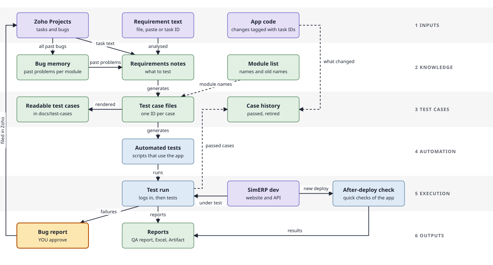
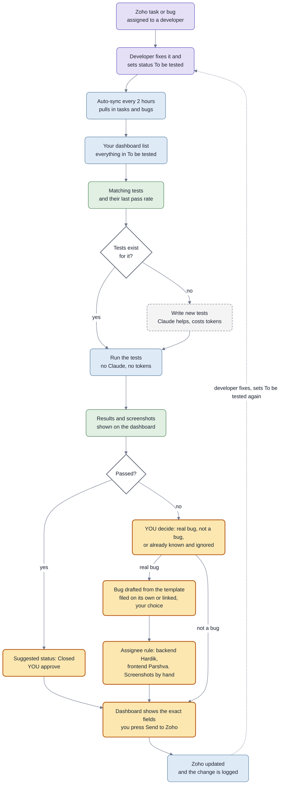
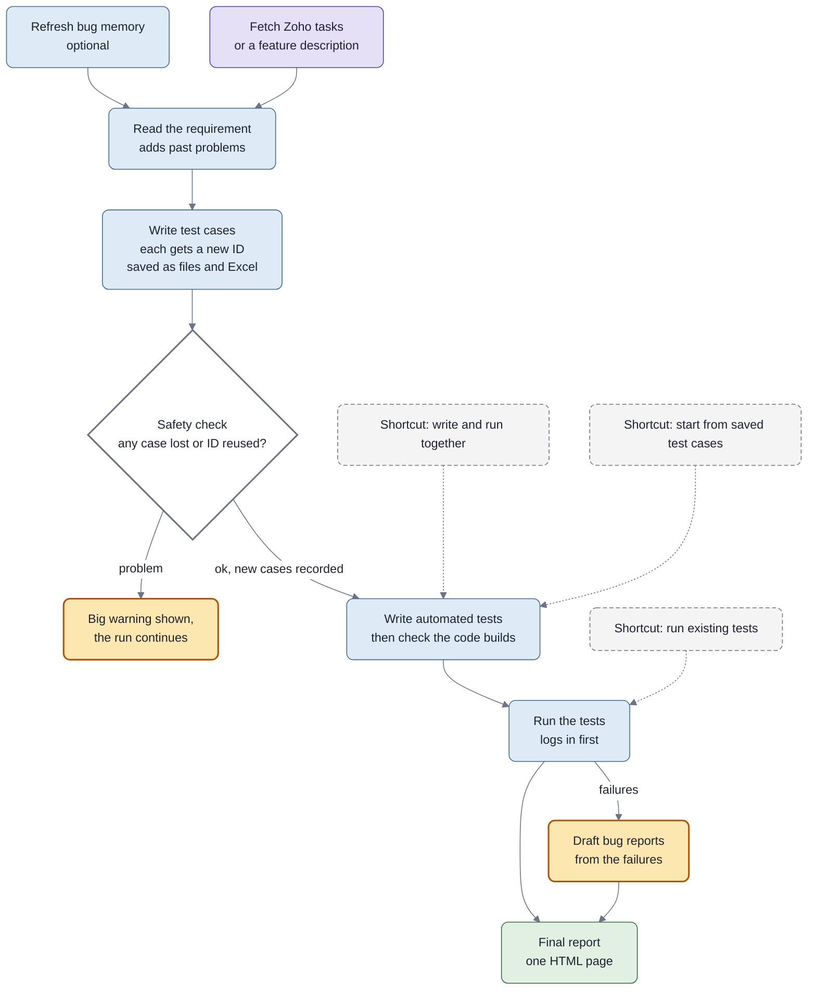
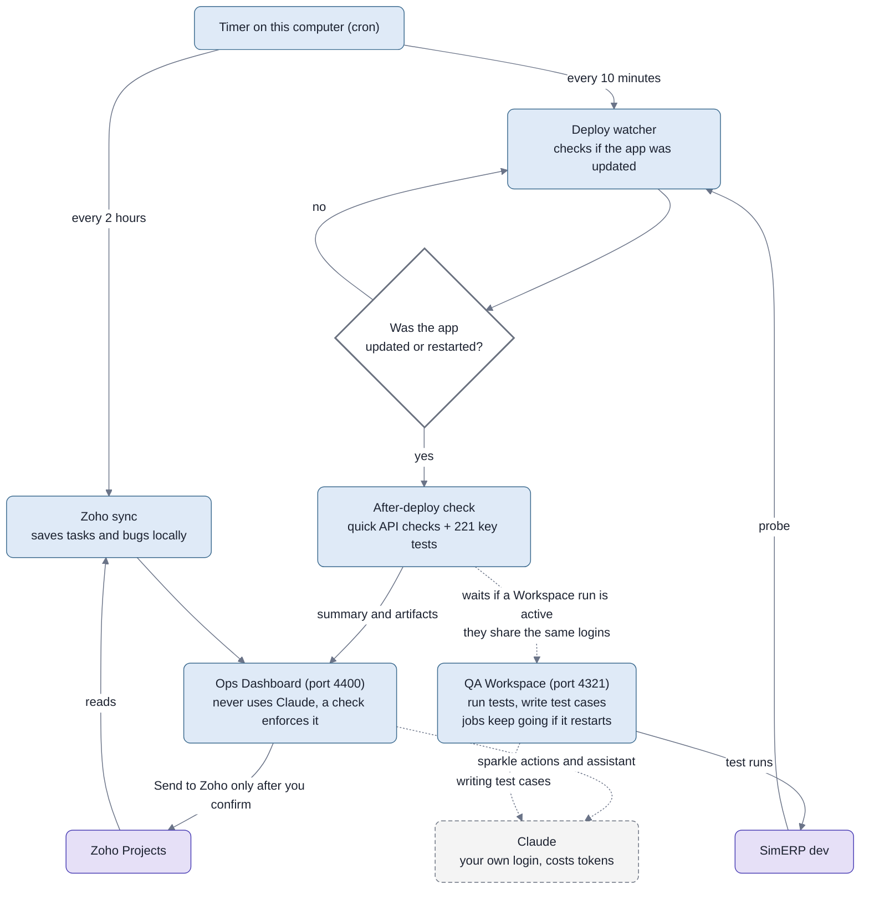
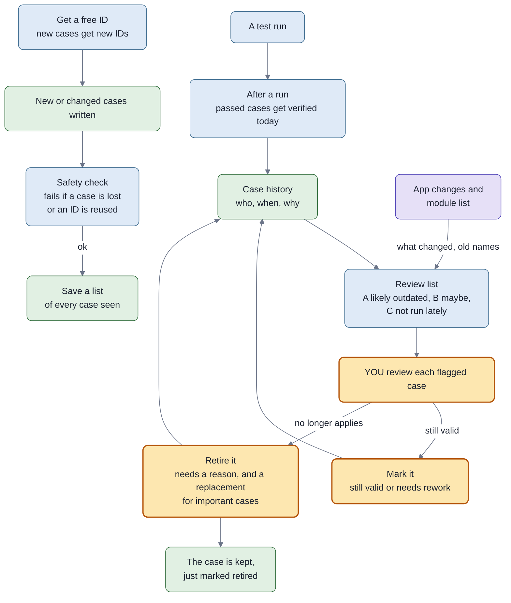
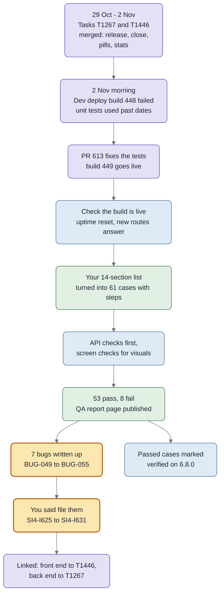

# QA system flow

How the QA system fits together: what runs, what depends on what, and how a Zoho task becomes a test result and a closed task. Diagrams are Mermaid (render on GitHub and in the published Artifact page). Edit `scripts` or this file when the process changes.

Legend: amber = you decide or approve, blue = runs by itself, green = stored data, purple = outside system, dashed grey = optional, uses Claude.

## 1. The whole system on one screen

Read it from the top down. Things come in at the top, get turned into test cases, then tests, then results, and the results end up as reports and bug reports at the bottom.

Bugs go back to Zoho. Past bugs are saved as 'bug memory', so the next set of test cases already knows what went wrong before.

## 2. How a task is handled

This is what happens from the moment a developer says a task is ready until it is closed. The amber boxes are your decisions. Nothing reaches Zoho until you see exactly what will be sent and press Send to Zoho.

Zoho status names other than To be tested, Closed and Not a Bug are the usual Zoho flow. To confirm in Zoho.

## 3. From a requirement to a report

The steps run in order. At each step you choose which earlier file to use, so it never quietly picks the newest one. The dashed boxes are shortcuts if you only want part of the steps.

The safety check only warns. It never stops the run.

## 4. What runs on its own

Two timers keep Zoho data fresh and notice when the app is updated. Claude is only used when you press a sparkle button or use the QA Workspace, and it always uses your own login.

No tokens are used by: the Zoho sync, the deploy watcher, the after-deploy check, running tests, or the case commands. Tokens are used by: the sparkle buttons, the assistant, 'New requirement', and this chat.

## 5. Keeping old test cases honest

Test cases get old when the app changes. Nothing is ever deleted: a case is marked when it passes, flagged when its feature changes, and only retired with a reason.

After every test run, mark the passed cases as verified so they stop showing as 'not run lately'.

## 0. The short version

1. A developer finishes a task and sets it to To be tested in Zoho.
2. It appears on your dashboard (a timer pulls it in every 2 hours).
3. The tests run. If there are none, Claude can help write them.
4. You decide: fixed, a real bug, or not a bug.
5. You press Send to Zoho. A real bug goes back to the developer and the loop starts again.

## 6. What depends on what

| Piece | Needs | Needed by | If it is missing or broken |
| --- | --- | --- | --- |
| Zoho login token (.env) | A Zoho Self Client login that still works | Task and bug sync, the To-be-tested queue, bug filing, task fetch | Sync logs ok:false and exits quietly, so data goes stale without any alert. Fix: npm run zoho:reauth |
| SimERP dev site and API | A working dev deploy | Every test, every health run | Runs fail. deploy-watch notes a deploy that happened while dev was down and starts the health run when it is back |
| Saved role logins (global-setup) | Valid dev accounts in .env; a session is reused for up to 72 hours and checked with a live request | Every spec, every role | Re-logs in by itself. If auto-login fails a browser window waits for a person, so a run can hang at login |
| Knowledge base | Zoho bugs (kb:update) and past analyses | Requirement analyzer, case generator | Cases are still produced but lose known edge cases from past bugs |
| Case IDs and the snapshot | IDs that are never reused | Specs, reports, Excel, the lifecycle ledger | A reused ID silently overwrote older cases in 'newest file wins' reports. cases:check now fails on it |
| Module registry | Current names, routes, old names, app code folders | Stale review, renames | Old names are not detected; code-change signals fall back to age only |
| App repos next to this one | A local copy of the backend and frontend (SIMERP DEV) | Stale review, reading task commits as the spec for empty Zoho tasks | Only age and naming are used. Commits may be out of date until fetched |
| Timer on this computer (cron) | The computer being on | Zoho sync (2 h), deploy-watch (10 min) | Nothing runs and nothing catches up while it is off |
| One job at a time | Shared logins and a single queue | QA Workspace runs, health runs, Ops Dashboard runs | A second job waits for the first. Health runs wait for Workspace runs |
| Claude Code CLI | Your own Claude login (no API key) | Only the sparkle actions, assistant, pipeline AI steps, 'New requirement' | Everything else still works. Core Ops Dashboard has no Claude code at all |
| You and the QA lead | Decisions | Anything sent to Zoho, real allocations on dev, what counts as a bug | Nothing external happens without your OK. Rulings (not a bug, ignore) are kept so they are not raised again |

## 7. A real example: the interview re-test on 2 November

One real task, with the steps that were actually taken.

61 test cases, 53 passed, 7 bugs filed (SI4-I625 to SI4-I631).

## Words used here

- **To be tested**: The Zoho status that means a developer says the work is ready for QA.
- **Test case**: One written check, for example: release a candidate and see that the seat is freed.
- **Automated test**: A test case turned into a script that clicks through the app by itself.
- **After-deploy check**: Quick tests that start by themselves when the app is updated.
- **Bug memory**: A saved list of problems found before, so new test cases cover them.
- **Case history**: The record of when each test case last passed, and which ones were retired.
- **Token**: What AI services charge by. Using Claude costs tokens. The sync, the tests and the case commands do not.
- **Pipeline**: The steps in order, from a requirement to a report.
- **Cron**: A timer on this computer that starts a job on a schedule.